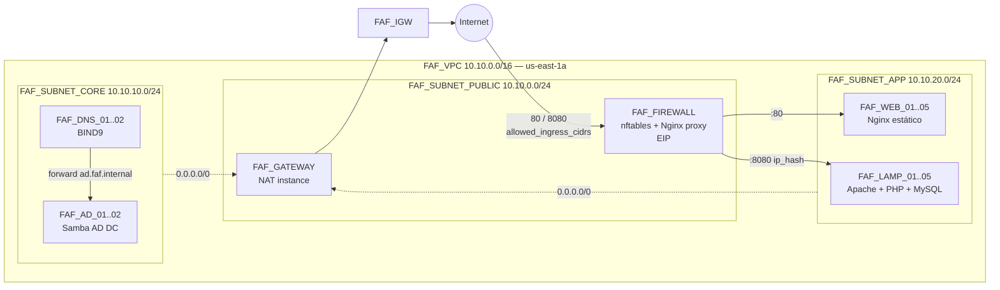
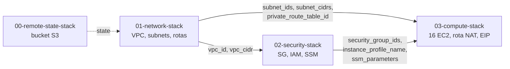

# terraform-aws-faf-lab

Laboratório de infraestrutura corporativa na AWS provisionado 100% com **Terraform**:
16 máquinas **Ubuntu 22.04 LTS** em `us-east-1` com Active Directory, DNS, firewall de
borda, gateway NAT e duas camadas web (estática e PHP + MySQL), seguindo a
[estrutura padrão de módulos](https://developer.hashicorp.com/terraform/language/modules/develop/structure)
e o [style guide](https://developer.hashicorp.com/terraform/language/style) da HashiCorp,
organizado em stacks independentes (rede → segurança → compute).

---

## Sumário

1. [Arquitetura](#arquitetura)
2. [Inventário das 16 máquinas](#inventário-das-16-máquinas)
3. [Nomenclatura](#nomenclatura)
4. [Estrutura do repositório](#estrutura-do-repositório)
5. [Pré-requisitos](#pré-requisitos)
6. [Início rápido](#início-rápido)
7. [Validação pós-deploy](#validação-pós-deploy)
8. [Custos](#custos)
9. [Segurança](#segurança)
10. [Limitações conhecidas](#limitações-conhecidas)
11. [Documentação](#documentação)

---

## Arquitetura



- **Entrada**: somente pelo `FAF_FIREWALL` (único IP público fixo). Nenhuma outra máquina recebe tráfego da internet.
- **Saída**: subnets privadas saem pelo `FAF_GATEWAY` (NAT instance com nftables masquerade).
- **Administração**: sem SSH e sem bastion — **AWS SSM Session Manager**.
- **Segredos**: senhas geradas pelo Terraform, guardadas no **SSM Parameter Store** (SecureString) e lidas pelas máquinas via IAM no boot.

Detalhes em [`docs/ARCHITECTURE.md`](docs/ARCHITECTURE.md).

## Inventário das 16 máquinas

| Serviço | Tag `Name` | Qtd | Tipo | Subnet | IPs fixos | Função |
|---|---|---|---|---|---|---|
| Gateway | `FAF_GATEWAY` | 1 | t3.micro | public | 10.10.0.10 | NAT de saída |
| Firewall | `FAF_FIREWALL` | 1 | t3.micro | public | 10.10.0.20 + EIP | Borda, nftables, proxy reverso |
| Active Directory | `FAF_AD_01..02` | 2 | t3.small | core | 10.10.10.10–11 | Samba AD DC (`AD.FAF.INTERNAL`) |
| DNS | `FAF_DNS_01..02` | 2 | t3.micro | core | 10.10.10.20–21 | BIND9 primário/secundário (`faf.internal`) |
| Site PHP + MySQL | `FAF_LAMP_01..05` | 5 | t3.small | app | 10.10.20.10–14 | Apache, PHP, MySQL local |
| Site estático | `FAF_WEB_01..05` | 5 | t3.micro | app | 10.10.20.40–44 | Nginx |
| **Total** | | **16** | | | | |

Quantidades, tipos e IPs são configuráveis em `services` ([`03-compute-stack/terraform.tfvars`](03-compute-stack/terraform.tfvars)).

## Nomenclatura

| Recurso | Padrão | Exemplo |
|---|---|---|
| Instância única | `FAF_<SERVICO>` | `FAF_FIREWALL` |
| Instâncias múltiplas | `FAF_<SERVICO>_NN` | `FAF_WEB_03` |
| Rede / SG / IAM | `FAF_<TIPO>_<NOME>` | `FAF_SUBNET_APP`, `FAF_SG_LAMP`, `FAF_ROLE_EC2_SSM` |
| Hostname do SO | `faf-<servico>-NN` | `faf-web-03.faf.internal` |
| Bucket de state | `faf-tfstate-<conta>-<região>` | `faf-tfstate-123456789012-us-east-1` |

**Exceções obrigatórias (regras externas, não escolha):**
hostnames não aceitam `_` (RFC 1123) e buckets S3 não aceitam maiúsculas nem `_`.
Por isso ambos usam minúsculas com hífen. Ver [`docs/adr/0001-nomenclatura.md`](docs/adr/0001-nomenclatura.md).

## Estrutura do repositório

Organização em **stacks numeradas** (uma pasta = um state = um `terraform apply`) e
**um arquivo por recurso**, no padrão `<domínio>.<componente>.tf`
(`vpc.subnets.tf`, `sg.firewall.tf`, `ec2.lamp.tf`). Racional em [ADR 0006](docs/adr/0006-stacks.md).

```text
terraform-aws-faf-lab/
├── 00-remote-state-stack/          # [1x] bucket S3 do state (state local)
│   ├── s3.state-bucket.tf  s3.encryption.tf  s3.public-access.tf
│   ├── s3.lifecycle.tf     s3.bucket-policy.tf
│   └── data.aws.tf  outputs.tf  providers.tf  terraform.tf  variables.tf
│
├── 01-network-stack/               # FAF_VPC, subnets, rotas, IGW, flow logs
│   ├── vpc.tf                      vpc.subnets.tf
│   ├── vpc.internet-gateway.tf     vpc.route-tables.tf
│   ├── vpc.default-security-group.tf  vpc.flow-logs.tf
│   └── backend.tf  locals.tf  outputs.tf  providers.tf  terraform.tf
│       terraform.tfvars  variables.tf  variables.shared.tf
│
├── 02-security-stack/              # security groups, IAM, segredos
│   ├── sg.gateway.tf  sg.firewall.tf  sg.ad.tf  sg.dns.tf  sg.lamp.tf  sg.web.tf
│   ├── sg.egress.tf
│   ├── iam.ec2-role.tf  iam.instance-profile.tf
│   ├── ssm.ad-admin.tf  ssm.lamp-db.tf
│   └── data.aws.tf  data.remote-state.tf  backend.tf  locals.tf  outputs.tf ...
│
├── 03-compute-stack/               # as 16 EC2
│   ├── ec2.gateway.tf  ec2.firewall.tf  ec2.ad.tf  ec2.dns.tf  ec2.lamp.tf  ec2.web.tf
│   ├── ec2.user-data.tf            # renderização do cloud-init
│   ├── data.ami.tf  data.remote-state.tf
│   ├── templates/                  # common.sh + <servico>.sh (.tftpl)
│   ├── examples/minimal.tfvars     # 6 VMs para teste barato
│   └── backend.tf  locals.tf  outputs.tf  providers.tf  terraform.tf
│       terraform.tfvars  variables.tf  variables.shared.tf
│
├── modules/ec2_instance/           # hardening reutilizado por todos os ec2.*.tf
├── docs/                           # arquitetura, deploy, runbook, segurança, custos, ADRs
├── .github/                        # CI (fmt, validate por stack, tflint, checkov) + Dependabot
├── .env.example  .tflint.hcl  Makefile  CHANGELOG.md  LICENSE
```

### Convenção de arquivos

| Arquivo | Conteúdo |
|---|---|
| `terraform.tf` | `required_version` e `required_providers` |
| `providers.tf` | provider AWS + `default_tags` |
| `backend.tf` | backend S3 (configuração parcial) |
| `variables.shared.tf` | variáveis comuns às stacks (identidade/tags, remote state) |
| `variables.tf` | variáveis específicas da stack |
| `terraform.tfvars` | valores **não sensíveis** da stack (versionado) |
| `locals.tf` | nomes, tags e valores derivados |
| `data.<origem>.tf` | data sources (`data.ami.tf`, `data.remote-state.tf`) |
| `<domínio>.<componente>.tf` | recursos de um componente (`sg.lamp.tf`, `ec2.firewall.tf`) |
| `outputs.tf` | **contrato** lido pelas stacks seguintes |

### Dependência entre stacks



Deploy: **00 → 01 → 02 → 03**. Destroy: **03 → 02 → 01**. As saídas são lidas com `terraform_remote_state`.

## Pré-requisitos

| Ferramenta | Versão | Uso |
|---|---|---|
| Terraform | ≥ 1.10 | lock nativo do backend S3 (`use_lockfile`) |
| AWS CLI v2 | atual | credenciais e SSM |
| Session Manager Plugin | atual | `aws ssm start-session` |
| make, jq | — | atalhos do Makefile |
| tflint, checkov | opcional | `make check` |

Permissões IAM do operador: EC2, VPC, IAM (roles/policies/instance profiles), SSM Parameter Store, S3 (state), CloudWatch Logs (se flow logs).

## Início rápido

```bash
# 1. Configuração local
cp .env.example .env              # ajuste AWS_PROFILE e TF_VAR_allowed_ingress_cidrs (seu IP/32)
aws sso login --profile faf-lab

# 2. Remote state (apenas na primeira vez)
make bootstrap                    # copie 'state_bucket' para TF_STATE_BUCKET no .env

# 3. Verificações
make check                        # fmt, validate (todas as stacks), tflint, checkov

# 4. Deploy, stack por stack
make init plan STACK=01-network-stack   && make apply STACK=01-network-stack
make init plan STACK=02-security-stack  && make apply STACK=02-security-stack
make init plan STACK=03-compute-stack   && make apply STACK=03-compute-stack
#    ou tudo em sequência, com confirmação entre as stacks:
make deploy-all

# 5. Resultado
make output
make inventory
```

Teste barato (6 VMs): `make plan STACK=03-compute-stack VAR_FILE=examples/minimal.tfvars`.
O bootstrap das máquinas leva de **5 a 10 minutos** após o apply da 03.
Passo a passo em [`docs/DEPLOYMENT.md`](docs/DEPLOYMENT.md).

## Validação pós-deploy

```bash
FW=$(terraform -chdir=03-compute-stack output -json firewall_public_ips | jq -r '.FAF_FIREWALL')

curl -s  http://$FW/healthz                 # ok
curl -sI http://$FW/      | grep X-FAF      # backend FAF_WEB que respondeu
curl -s  http://$FW:8080/ | grep '<h1>'     # nó FAF_LAMP + contador do MySQL

make logs NAME=FAF_AD_02                    # log de bootstrap via SSM
make ssm  NAME=FAF_DNS_01                   # shell interativo
```

Checklist por serviço em [`docs/RUNBOOK.md`](docs/RUNBOOK.md#2-validação-por-serviço).

## Custos

Estimativa on-demand em `us-east-1` com a configuração padrão (16 VMs):

| Item | ~USD/hora | ~USD/mês (730 h) |
|---|---|---|
| 9× t3.micro + 7× t3.small | 0,24 | 175 |
| EBS gp3 (230 GiB) | — | 18 |
| 2 IPv4 públicos | 0,01 | 7 |
| **Total** | **~0,27** | **~200** |

> Laboratório de portfólio: **suba, demonstre e destrua** (`make destroy-all`). Uma demo de 4 h custa cerca de USD 1.
> Use `03-compute-stack/examples/minimal.tfvars` (6 VMs) para testes. Valores de referência — confirme no
> [AWS Pricing Calculator](https://calculator.aws/). Detalhes em [`docs/COSTS.md`](docs/COSTS.md).

## Segurança

- Zero portas administrativas abertas (sem 22/3389); acesso via SSM.
- IMDSv2 obrigatório; EBS criptografado; SG default sem regras.
- `FAF_WEB`/`FAF_LAMP` só aceitam tráfego **vindo do SG do firewall** (referência de SG, não CIDR).
- MySQL ouvindo só em `127.0.0.1`; root com `auth_socket`.
- Segredos fora do user_data e do repositório; state em S3 criptografado, versionado, com TLS obrigatório.
- CI com Checkov; exceções justificadas em [`docs/SECURITY.md`](docs/SECURITY.md).

## Limitações conhecidas

| Limitação | Impacto | Caminho para produção |
|---|---|---|
| Ubuntu 22.04: suporte padrão até **abr/2027** | Migração em ~5 meses | Ubuntu 24.04 (troca do filtro em `03-compute-stack/data.ami.tf`) ou Ubuntu Pro/ESM |
| AD em Samba, não Windows Server | Sem GPO completa nem replicação de SYSVOL | Windows Server / AWS Managed Microsoft AD |
| 5 MySQL independentes no LAMP | Cada nó tem seus próprios dados | Amazon RDS Multi-AZ ou nó de banco dedicado |
| AZ única e NAT/Firewall únicos | SPOF de entrada e saída | Multi-AZ + NAT Gateway + ALB/AWS Network Firewall |
| `ignore_changes = [ami, user_data]` | Mudança de script exige `-replace` | Imagem com Packer + Auto Scaling Group |
| Variáveis comuns duplicadas em `variables.shared.tf` | Mudança precisa ser replicada nas 3 stacks | Terragrunt / Terraform Stacks |

Racional de cada decisão em [`docs/adr/`](docs/adr/).

## Documentação

| Documento | Conteúdo |
|---|---|
| [`docs/ARCHITECTURE.md`](docs/ARCHITECTURE.md) | Topologia, fluxos, plano de IPs, DNS/AD |
| [`docs/DEPLOYMENT.md`](docs/DEPLOYMENT.md) | Deploy do zero, passo a passo |
| [`docs/RUNBOOK.md`](docs/RUNBOOK.md) | Todas as ações operacionais: validar, escalar, recriar, rotacionar, destruir |
| [`docs/TROUBLESHOOTING.md`](docs/TROUBLESHOOTING.md) | Sintoma → causa → correção |
| [`docs/SECURITY.md`](docs/SECURITY.md) | Controles, segredos, exceções do Checkov |
| [`docs/COSTS.md`](docs/COSTS.md) | Estimativa e como reduzir |
| [`docs/adr/`](docs/adr/) | Registros de decisão arquitetural (inclui o layout em stacks, ADR 0006) |
| [`CHANGELOG.md`](CHANGELOG.md) | Histórico de versões |

## Licença

[MIT](LICENSE)
