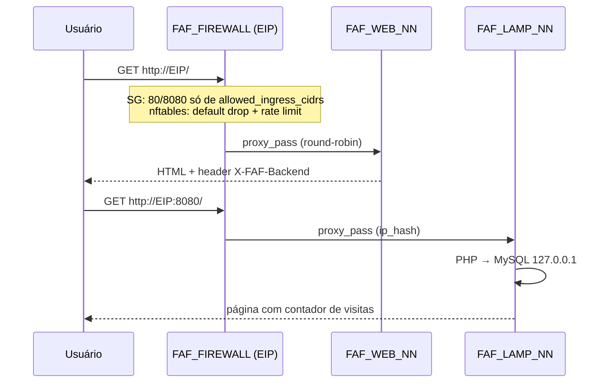
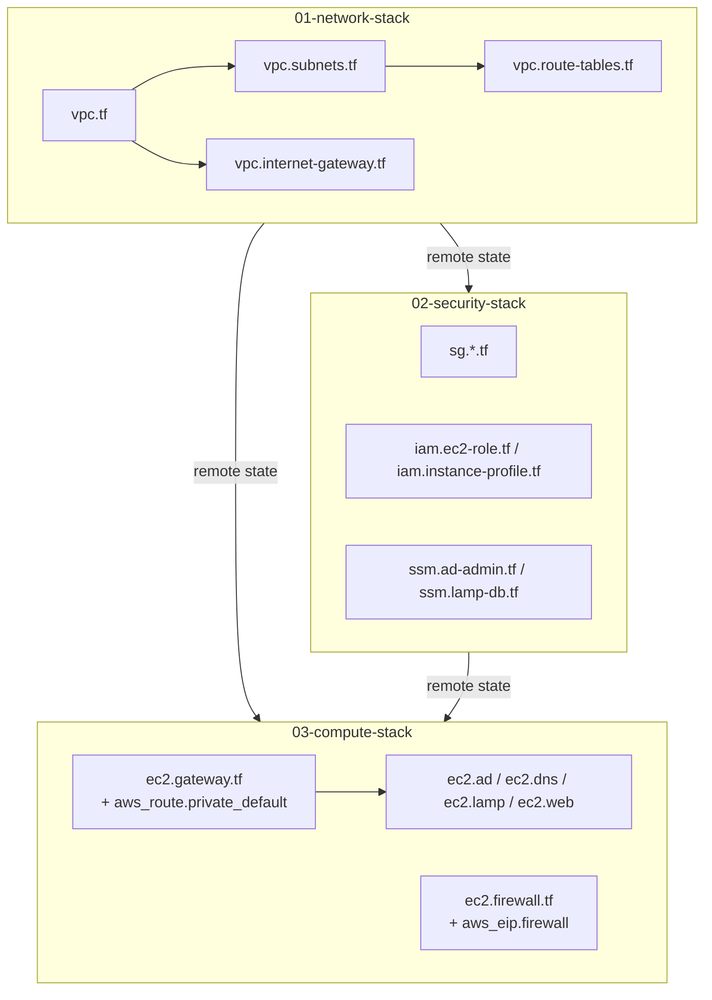

# Arquitetura

## 1. Visão geral

| Camada | Subnet | Serviços | Exposição |
|---|---|---|---|
| Borda | `FAF_SUBNET_PUBLIC` 10.10.0.0/24 | FAF_FIREWALL, FAF_GATEWAY | Firewall: EIP, portas 80/8080 para `allowed_ingress_cidrs`. Gateway: IP público só para saída |
| Core | `FAF_SUBNET_CORE` 10.10.10.0/24 | FAF_AD, FAF_DNS | Somente VPC |
| Aplicação | `FAF_SUBNET_APP` 10.10.20.0/24 | FAF_LAMP, FAF_WEB | Somente via FAF_FIREWALL |

Região `us-east-1`, AZ única `us-east-1a` (ver [ADR 0003](adr/0003-single-az.md)).

## 2. Fluxos de tráfego

### 2.1 Entrada (usuário → site)



### 2.2 Saída (subnets privadas → internet)

```
FAF_AD / FAF_DNS / FAF_LAMP / FAF_WEB
   └─ FAF_RT_PRIVATE: 0.0.0.0/0 → ENI do FAF_GATEWAY
        └─ nftables: forward permitido só de 10.10.0.0/16 + masquerade na interface WAN
             └─ FAF_RT_PUBLIC: 0.0.0.0/0 → FAF_IGW
```

Requisito: `source_dest_check = false` na ENI do gateway (`03-compute-stack/locals.tf`).
A rota `0.0.0.0/0` da `FAF_RT_PRIVATE` fica em `03-compute-stack/ec2.gateway.tf`, pois aponta para a ENI da instância.

### 2.3 Administração

Nenhuma porta de administração aberta. O agente SSM (pré-instalado na AMI Ubuntu)
se conecta de dentro para fora em 443 → endpoints SSM. Acesso:
`make ssm NAME=FAF_AD_01`.

## 3. Plano de endereçamento

IPs são **fixos e determinísticos**: `cidrhost(subnet, ip_offset + índice)`.
Isso permite renderizar em tempo de *plan* a zona DNS, o upstream do proxy e o IP do DC primário,
sem dependência circular entre instâncias.

| Faixa | Reservado para |
|---|---|
| `.0`–`.3`, `.255` | AWS (rede, router, DNS, futuro, broadcast) |
| public `.10` | FAF_GATEWAY |
| public `.20+` | FAF_FIREWALL |
| core `.10–.19` | FAF_AD (até 10 DCs) |
| core `.20–.29` | FAF_DNS (até 10) |
| app `.10–.39` | FAF_LAMP (até 30) |
| app `.40–.69` | FAF_WEB (até 30) |
| `10.10.0.2` | AmazonProvidedDNS (forwarder) |

## 4. Diretório e nomes

```
faf.internal                 → zona BIND9 (FAF_DNS_01 primário, _02 secundário via AXFR/NOTIFY)
 ├─ faf-<servico>-NN         → registro A de cada uma das 16 máquinas
 ├─ gateway / firewall / ad  → CNAMEs
 └─ ad.faf.internal          → zona encaminhada (forward only) para FAF_AD_01/02
      └─ Samba AD DC, DNS interno do Samba, realm AD.FAF.INTERNAL, NetBIOS FAF
```

- **FAF_AD_01** provisiona o domínio (`samba-tool domain provision --use-rfc2307`).
- **FAF_AD_02** espera o LDAP do 01, e entra como DC adicional (`samba-tool domain join ... DC`) — replicação do diretório via DRS.
- Senha do `Administrator`: SSM `/faf/lab/ad/admin_password`.
- Hora: Amazon Time Sync (`169.254.169.123`) via chrony — Kerberos falha com skew > 5 min.

> A VPC continua usando o AmazonProvidedDNS via DHCP. Os clientes que devem resolver
> `faf.internal` apontam explicitamente para `FAF_DNS`. Trocar o DHCP Options Set da VPC
> para os IPs do FAF_DNS é possível, mas cria dependência de boot (as máquinas precisariam
> do DNS antes dele existir). Ver [ADR 0005](adr/0005-dns-bind-mais-samba.md).

## 5. Bootstrap (cloud-init)

Cada máquina recebe `common.sh` + `<servico>.sh` renderizados por `templatefile()` em
`03-compute-stack/ec2.user-data.tf` (templates em `03-compute-stack/templates/`):

| Etapa | common.sh |
|---|---|
| 1 | Hostname RFC 1123 + /etc/hosts |
| 2 | Espera saída para a internet (até 10 min, via NAT) |
| 3 | Pacotes base, AWS CLI (snap), chrony, unattended-upgrades |
| 4 | Funções `retry`, `wait_for_port`, `get_secret` |

| Serviço | Script | Resultado |
|---|---|---|
| gateway | `gateway.sh.tftpl` | ip_forward + nftables masquerade |
| firewall | `firewall.sh.tftpl` | nftables default-drop + Nginx proxy (80→WEB, 8080→LAMP) |
| ad | `ad.sh.tftpl` | Samba AD DC primário ou adicional |
| dns | `dns.sh.tftpl` | BIND9 primário/secundário + forward da zona AD |
| lamp | `lamp.sh.tftpl` | Apache + PHP + MySQL local + app de exemplo |
| web | `web.sh.tftpl` | Nginx estático |

Log: `/var/log/faf-bootstrap.log`. Sucesso: `/var/lib/faf/bootstrap.done`.

## 6. Stacks e ordem de criação



| Stack | Lê de | Exporta (`outputs.tf`) |
|---|---|---|
| 01-network | — | `vpc_id`, `vpc_cidr`, `subnet_ids`, `subnet_cidrs`, `private_route_table_id`, `availability_zone` |
| 02-security | 01 | `security_group_ids`, `instance_profile_name`, `ec2_role_arn`, `ssm_parameters` |
| 03-compute | 01, 02 | inventário, IPs, URLs, comandos SSM |

Dentro da 03, os módulos `ec2_ad`, `ec2_dns`, `ec2_lamp` e `ec2_web` têm `depends_on`
na rota NAT: sem ela, o `apt` das máquinas privadas falharia.
